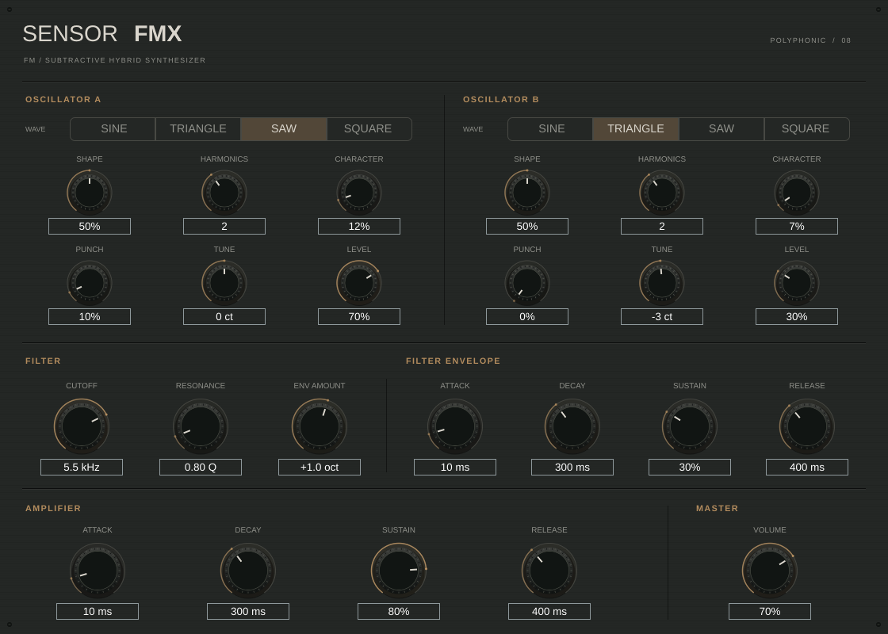

# SENSOR FMX

FM / SUBTRACTIVE HYBRID SYNTHESIZER — prototype 0.2

A conventional two-oscillator synthesizer that gradually opens into FM coloration. Choose a familiar waveform, shape it, add Character or transient Punch, then sculpt the result with the filter. Eight voices, sustain pedal, ±2-semitone pitch bend, VST3 and standalone targets. All 26 visible parameters support automation and project recall.



## Build on Windows

Install Git, CMake 3.22+ and a current Visual Studio installation with **Desktop development with C++**, MSVC and a Windows SDK. Open its Developer PowerShell:

```powershell
git clone https://github.com/AakeKBergh/SensorFMX.git
cd SensorFMX
cmake -S . -B build
cmake --build build --config Release --parallel 2
ctest --test-dir build -C Release --output-on-failure
```

CMake selects the installed default generator. To choose a particular Visual Studio version, use the exact generator name listed by `cmake --help` with `-G`, and `-A x64` if desired. Choose it on the first configure or use a fresh build directory when changing generator. The project does not pin a Visual Studio version.

CMake downloads JUCE 8.0.6 at commit `51a8a6d7aeae7326956d747737ccf1575e61e209`, including its VST3 SDK. No separate SDK or Windows-specific dependency is required. GitHub access is needed for the first configure. To use an existing JUCE source checkout, add `-DJUCE_DIR=C:/path/to/JUCE`.

With a multi-configuration Visual Studio generator, the plugin bundle is `build/SensorFMX_artefacts/Release/VST3/SENSOR FMX.vst3`. Copy the entire bundle into `C:/Program Files/Common Files/VST3/` and rescan your DAW; administrator permissions may be required. The standalone executable is `build/SensorFMX_artefacts/Release/Standalone/SENSOR FMX.exe`. With a single-configuration generator, configure using `-DCMAKE_BUILD_TYPE=Release`.

The previous version was reported working on Windows. This revision is built and tested in Linux; Windows compilation, GUI scaling and DAW playback need verification on Windows.

## Build on Linux / macOS

C++17, CMake 3.22+ and Git are required. On Debian/Ubuntu:

```sh
sudo apt-get update
sudo apt-get install -y build-essential cmake pkg-config libasound2-dev libx11-dev libxext-dev libxinerama-dev libxrandr-dev libxcursor-dev libfreetype6-dev libfontconfig1-dev libgl1-mesa-dev xvfb xauth
cmake -S . -B build -DCMAKE_BUILD_TYPE=Release
cmake --build build --parallel 2
xvfb-run -a ctest --test-dir build --output-on-failure
```

On macOS install Xcode command line tools and CMake; use the configure/build commands above and run CTest without `xvfb-run`. macOS is not validated here.

Standalone applications are under `build/SensorFMX_artefacts/Release/Standalone/`, VST3 bundles under `build/SensorFMX_artefacts/Release/VST3/`. Linux VST3 installation usually uses `~/.vst3/`. The standalone application's audio settings select the audio device and MIDI input. There is no on-screen MIDI keyboard.

### Prepared cloud environment

```sh
. /workspace/toolchain/activate.sh
cd /workspace/SensorFMX
cmake -S . -B build-linux -G 'Unix Makefiles' \
  -DJUCE_DIR=/workspace/toolchain/JUCE -DCMAKE_BUILD_TYPE=Release \
  -DCMAKE_PREFIX_PATH=/workspace/toolchain/root/usr
cmake --build build-linux --parallel 2
xvfb-run -a ctest --test-dir build-linux --output-on-failure -V
```

This machine's toolchain lives outside the repository. Local Windows/Linux builds use the normal prerequisites above. No cloud paths are needed by CMake. Xvfb verifies off-screen GUI rendering, not interactive playback through a physical audio device.

## Oscillator controls

| Control | Behavior |
| --- | --- |
| Wave | Sine, Triangle, Saw or Square is the audible carrier. |
| Shape | Neutral at 50%. Sine adds a subtle second harmonic; Triangle shifts its peak; Saw adds soft saturation away from centre; Square adjusts pulse width from 10–90%, with DC compensation. |
| Harmonics | Stepped selector: 0.5, 1, 1.5, 2, 3, 4, 5, 6 or 8. These set the hidden modulator's frequency relationship. |
| Character | 0–100% steady FM coloration, with a cubic depth curve: 0 at minimum, 0.5 radians at 50%, 4 radians at maximum. The lower half stays gentle. |
| Punch | Extra FM at note onset: depth `3 × Punch²` radians, decaying exponentially with an automatically selected 35–140 ms time constant. At 0% there is no transient modulation. |
| Tune | Fine tuning, ±100 cents; pitch bend remains available. |
| Level | Oscillator mixer level. |

Default patch: A = Saw, Shape 50%, Harmonics 2, Character 12%, Punch 10%, Tune 0 ct, Level 70%. B = Triangle, Shape 50%, Harmonics 2, Character 7%, Punch 0%, Tune −3 ct, Level 30%. Filter starts at 5.5 kHz, low resonance and +1 octave envelope. Amp attack is 10 ms, decay 300 ms, sustain 80%, release 400 ms.

## Sound design starting points

These are manual recipe suggestions, not bundled preset programs. Start from the default and adjust to taste:

| Sound | Starting changes |
| --- | --- |
| Bass | Use Saw + Square, lower filter cutoff to 500–1000 Hz, short filter decay, Character 5–20%. Play in the bass register. |
| Pad | Saw + Triangle, detune a few cents, amp attack 500 ms and release 2 s, gentle Character and low Punch. |
| Lead | Saw + Square, open the filter, Character 20–40%, slight resonance, amp release around 150 ms. |
| Pluck | Punch 30–60%, low filter sustain, fast filter decay, short amp decay and low amp sustain. |

## Signal path and DSP

For each voice:

`Wave + Shape → steady Character / transient Punch phase coloration → A/B level mixer → resonant low-pass + filter ADSR → amp ADSR`

Voices then sum into the smoothed master volume. The modulator is a sine at `carrier frequency × selected harmonic ratio`. Character is sustained; Punch decays independently after each note. Carrier/modulator phases, Punch state, filter and envelopes are independent per voice. Fine tuning affects both carrier and modulator. Phases remain continuous through pitch and parameter changes. Wave changes crossfade for 10 ms; continuous oscillator parameters, ratio transitions, cutoff, resonance, envelope amount and master use 20 ms smoothing.

At Character/Punch 0 and Shape 50%, the waveforms remain conventional. Saw and Square use polyBLEP edge correction to reduce ordinary oscillator aliasing. Triangle is a direct piecewise-linear waveform. Phase-modulated discontinuous waveforms, extreme Shape, high notes and high Character can still alias; this prototype does not use oversampling. Resonance can boost peaks, so reduce master volume with extreme settings.

There are eight voices including release tails. Further notes are ignored while all voices are occupied, avoiding abrupt stolen-voice edges. Minimum attack/release times and envelope-controlled note starts/stops prevent hard normal note edges. No buffers or parameter containers are allocated in the audio callback.

## GUI and automation

A single graphite front panel uses fine etched dividers, quiet machining lines, off-white industrial labels and warm amber illumination. Custom knurled rotary dials have fine perimeter ridges and an illuminated index/arc. Each oscillator has four waveform buttons plus six dials; Harmonics is a stepped dial. Value labels use Hz/kHz, cents, percentages, ms/seconds and simple harmonic positions. Editable values support those displayed units. Drag dials to automate, double-click to restore defaults, or edit the value text.

Shared parameter IDs (`aLevel`, `aFine`, filter, envelopes, master, and B equivalents) are retained. New oscillator IDs are `aWave`, `aShape`, `aHarmonics`, `aCharacter`, `aPunch` and B equivalents. Removed technical parameters are not exposed as host controls. Schema v2 state restores every parameter; missing parameters use deterministic new-patch defaults. Legacy v1 project state keeps common values, maps old ratios to the nearest supported harmonic ratio, and approximates old FM depth with a sine carrier and Character. The old FM decay behavior cannot be reproduced exactly, and old automation lanes for removed IDs cannot migrate automatically.

## Source layout and tests

- `HybridOscillator.h`: familiar carrier waveforms, Shape, macro mapping, smoothing and Punch.
- `SynthVoice.h`, `SynthSound.h`: per-voice DSP, envelopes and MIDI behavior.
- `Parameters.h`: stable APVTS parameter definitions, ranges and defaults.
- `PluginProcessor.*`: voice mixing, master gain, state versioning and legacy fallback.
- `PluginEditor.*`, `CameraKnob.h`, `WaveSelector.h`, `CustomLookAndFeel.h`: UI components, host attachments and procedural hardware styling.
- `Tests/SmokeTests.cpp`: conventional waveform references, harmonic spectra, Character/Punch/Shape, ratio mapping, automation, polyphony, pitch, sustain/release, state and GUI rendering.

Validation for this revision: both Linux VST3 and Standalone targets build successfully; the smoke suite passes 48 checks, including three sample rates (44.1/48/96 kHz), spectral behavior, MIDI, state migration and GUI attachments. Windows/macOS validation remains manual.

JUCE is a separate dependency; review its licensing terms before distribution.
